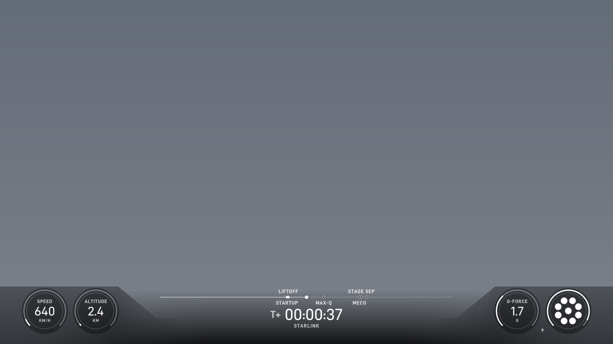

<div align="center">


</div>

## 🛰️ Mission manifest

| Mod | What it does | Release |
|:--|:--|:--|
| 📺 **[SPX Webcast Overlay](https://github.com/MXZZ123/SPXWebcastOverlay)** | Falcon 9 webcast-style telemetry overlay: T-/T+ clock, event timeline, speed / altitude / G and engine gauges | [](https://github.com/MXZZ123/SPXWebcastOverlay/releases/latest) |
| 🪶 **[GridFinStepDeploy](https://github.com/MXZZ123/GridFinStepDeploy)** | Falcon 9-style stepped grid fin deploy with hinge-impact lock and an in-game tweak window | [](https://github.com/MXZZ123/GridFinStepDeploy/releases/latest) |

<table>
<tr>
<td width="50%" align="center">
<a href="https://github.com/MXZZ123/SPXWebcastOverlay"></a>
<br/><sub><b>SPX Webcast Overlay</b></sub>
</td>
<td width="50%" align="center">
<a href="https://github.com/MXZZ123/GridFinStepDeploy"></a>
<br/><sub><b>GridFinStepDeploy</b> deploy profile</sub>
</td>
</tr>
</table>

## 🔭 In the hangar

```text
VEHICLE              STATUS
-------------------  -----------------------------
RocketJellyfish      twilight plume effects    [WIP]
BoosterSoot          entry-burn soot buildup   [WIP]
PlumeImpact          plume / surface effects   [WIP]
EngineTransients     Merlin start & shutdown   [WIP]
```

## 🔧 Launch stack


## 📡 Telemetry

<div align="center">


</div>

<div align="center">

*"Falcon 9 has landed."* 🚀


</div>
